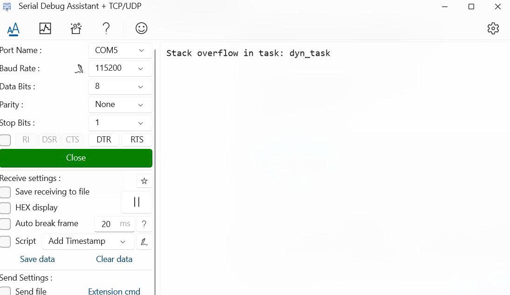
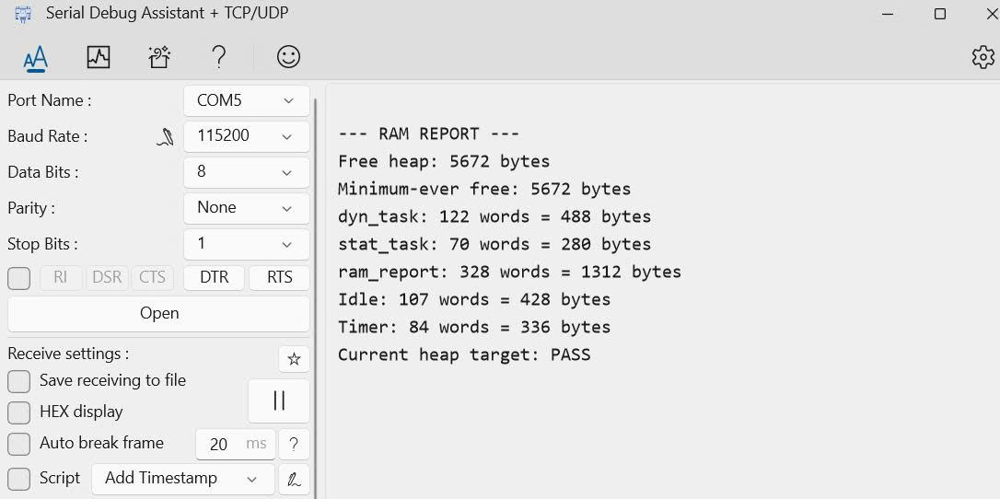

# Report — Week 1 / Ex4

`student_id`: 2510379    Commit của PREDICTION.md: 269601d


## 1. Ngân sách RAM từ `.map`
| Mục | Symbol / section trong `.map` | Bytes |
|---|---|---|
| `.data` | .data | 96 |
| `.bss` (không kể heap) | .bss | 2924 |
| Heap FreeRTOS (`ucHeap`) | ucHeap | 9216 |
| Stack của main (MSP) | _Min_Stack_Size | 1024 |
| Còn lại / chưa dùng | — | 7220 |
| **Tổng** | | **20480** |

`.map` commit tại: `______`

## 2. Số lúc chạy (dán nguyên văn log UART)
```
--- RAM REPORT ---
Free heap: 6296 bytes
Minimum-ever free: 6296 bytes
dyn_task: 133 words = 532 bytes
stat_task: 70 words = 280 bytes
ram_report: 328 words = 1312 bytes
Idle: 105 words = 420 bytes
Timer: 84 words = 336 bytes
Current heap target: PASS
```

| Đại lượng | Words | Bytes |
|---|---|---|
| `xPortGetFreeHeapSize()` | — | 6296 |
| `xPortGetMinimumEverFreeHeapSize()` | — | 6296 |
| HWM `dyn_task` | 133 | 532 |
| HWM `stat_task` | 70 | 280 |
| HWM `ram_report_task` | 328 | 1312 |
| HWM idle task | 105 | 420 |
| HWM timer task | 84 | 336 |

Heap còn trống >= `TARGET_FREE_HEAP_BYTES` (4096)? 6296.

## 3. Đối chiếu `.map` vs runtime
Heap trong `.map` = 9216 byte ; `xPortGetFreeHeapSize()` = 6296 ; lệch = 2920 bytes.
Lệch này gồm những gì (liệt kê từng mục kèm số bytes):

| Khoản cấp phát | Cách tính | Bytes |
|---|---|---|
| Stack dyn_task | 160 words × 4 | 640 |
| TCB dyn_task | - | 92 |
| Stack ram_report_task | 512 words × 4 | 2048 |
| TCB ram_report_task | - | 92 |
| Header của 4 khối cấp phát | 4 × 8 | 32 |
| Đệm căn chỉnh cho 2 khối TCB | 2 × 4 | 8 |
| Block cuối quản lý heap (heap_4) | - | 8 |

## 4. Dynamic vs static
HWM của `dyn_task` và `stat_task` lệch 63 words dù làm cùng một việc. Vì sao?
`xTaskCreate` và `xTaskCreateStatic` khác nhau ở đâu về **nơi** TCB và stack nằm?

**Trả lời:**
- HWM đo số word còn trống ít nhất, nên chênh lệch này chủ yếu do hai task được cấp stack khác kích thước:
    + dyn_task: 160 words được cấp, dùng sâu nhất khoảng 160 − 133 = 27 words.
    + stat_task: 96 words được cấp, dùng sâu nhất khoảng 96 − 70 = 26 words.
Hai task dùng gần như cùng lượng stack; HWM của chúng lệch 63 words vì stack cấp cho dyn_task lớn hơn 64 words. Chênh 1 word ở mức sử dụng sâu nhất làm độ lệch HWM thành 63 thay vì 64.
- Khác biệt về nơi cấp phát là:
    + xTaskCreate: FreeRTOS cấp phát TCB và stack từ FreeRTOS heap.
    + xTaskCreateStatic: TCB và stack được cấp phát tĩnh từ mảng `StackType_t` mà ta khai báo, và nó nằm trong vùng .bss.
## 5. Tràn stack
Log/ảnh chứng minh hook đã chạy:



Tại sao trong `vApplicationStackOverflowHook` không được gọi hàm UART blocking
(hoặc: nếu bạn vẫn gọi được, giải thích tại sao nó không crash — và tại sao đó là may):

**Trả lời:**
- Trường hợp 1 — stack 160 words = 640 bytes
    + Riêng mảng HOG đã chiếm 640 bytes, trong khi task còn cần stack cho ngữ cảnh CPU, biến cục bộ và các hàm được gọi. Vì vậy, nhu cầu stack vượt vùng được cấp.
    + Khi debug, task đã chạy vào hàm HOG nhưng sau đó mắc tại configASSERT(uxSchedulerSuspended == 1U) trong vTaskDelay() do đó mẫu dữ có thể đã bị ghi đè.
    + Do đó, assert giữ CPU trong vòng vô tận trước khi kernel tới bước kiểm tra stack và gọi hook. Vì vậy, lần thử này không có log từ vApplicationStackOverflowHook().
- Trường hợp 2, khi em thử nâng stack lên 192 words = 768 bytes
    + Khi tăng stack lên 192 words và giữ nguyên mảng HOG 640 bytes, em đã nhận được thông báo tràn stack từ UART.
- Tổng quát, không nên gọi UART blocking trong vApplicationStackOverflowHook() vì hệ thống lúc này đã có lỗi bộ nhớ và đang trong quá trình chuyển task, nếu không xử lý việc tràn stack mà giữ CPU để truyền UART thì có thể bị ghi đè sang vùng nhớ quan trọng khác.
- Ở trường hợp 2, em nâng stack lên 192 words thì truyền được vì lúc đó stack tràn chưa ghi đè lên các dữ liệu quan trọng cho việc chuyển task và gọi hook.
## 6. Stack nhỏ nhất an toàn
| Lần thử | Stack (words) | HWM (words) | Kết quả |
|---|---|---|---|
| 1 | 160 | - | Tràn |
| 2 | 182 | - | Tràn |
| 3 | 217 | | |
| 4 | 218 | 31 | Chưa đủ biên an toàn |
| 5 | 219 | 33 | Biên an toàn >= 32 bit. |
Giá trị cuối cùng chọn: 219 words. Biên an toàn: 33 words. Lý do chọn biên đó:
- Em chọn stack 219 words, với HWM đo được 33 words = 132 bytes, đáp ứng yêu cầu biên an toàn tối thiểu 32 words của bài (được đo khi có mảng HOG_DEPTH_BYTES). Phần stack còn trống này giúp dự phòng mức sử dụng cao hơn chưa xuất hiện trong lần đo, đồng thời hạn chế cấp phát dư thừa. 
## 7. Lệch so với dự đoán
Mỗi dòng lệch + nguyên nhân.

| Mục | Bytes dự đoán | Bytes từ `.map` | Lệch (thực tế − dự đoán) | Nguyên nhân |
|---|---:|---:|---:|---|
| `.data` | 100 | 96 | −4 | Các biến được lưu trong .data là các biến được khai báo khác 0, ngoài những biến trong các file bài làm thì còn rất nhiều biến được khai báo trong các thư viện HAL, FreeRTOS. |
| `.bss` không kể heap FreeRTOS | 2500 | 2924 | +424 | Chưa dự trù đầy đủ các biến và buffer tĩnh của ứng dụng, HAL, FreeRTOS và thư viện C. |
| Heap FreeRTOS (`ucHeap`) | 9216 | 9216 | 0 | Kích thước heap được đặt đúng theo cấu hình. |
| Stack của main (MSP) | 1024 | 1024 | 0 | Mức dự trữ tối thiểu `_Min_Stack_Size` trong linker đúng với dự đoán. |
| Còn lại / chưa dùng | 7640 | 7220 | −420 | `.data` giảm 4 bytes và `.bss` tăng 424 bytes nên phần dư giảm 420 bytes. |
| **Tổng** | **20480** | **20480** | **0** | Tổng ngân sách bằng dung lượng SRAM 20 KB. |

## 8. Câu hỏi đánh đổi
Với `HEAP_SIZE_BYTES` = 9216 của bạn: nếu phải thêm một task nữa có stack 128 words,
**lấy RAM từ đâu**? Dựa vào bảng ngân sách của bạn, đưa ra 2 phương án kèm chi phí
cụ thể (bytes), rồi chọn một và **thực hiện, đo lại để chứng minh**.

**Trả lời:**
Với `HEAP_SIZE_BYTES = 9216 bytes`, em có hai phương án thêm task có stack 128 words:

| Phương án | Nguồn RAM | Chi phí |
|---|---|---:|
| Tạo động bằng `xTaskCreate()` | Phần còn trống trong FreeRTOS heap (`ucHeap`) | 624 bytes |
| Tạo tĩnh bằng `xTaskCreateStatic()` | Buffer do ứng dụng cung cấp trong `.bss` | 604 bytes, cộng căn chỉnh linker nếu có |

- Phương án 1: Cấp phát động: Stack chiếm `128 × 4 = 512 bytes`. Với TCB 92 bytes và căn chỉnh 8 bytes trong cấu hình hiện tại:
    + Stack và header: `512 + 8 = 520 bytes`.
    + TCB, header và căn chỉnh: `92 + 8 + 4 = 104 bytes`.
    + Tổng FreeRTOS heap cần cấp: `520 + 104 = 624 bytes`.

- Phương án 2: Cấp phát tĩnh: cần cấp mảng stack 512 bytes và TCB 92 bytes, tổng cộng 604 bytes cho stack của task.
    + Phương án này không giảm FreeRTOS heap nhưng làm tăng `.bss`, giảm phần SRAM còn lại.

- Lựa chọn và kiểm chứng: Em chọn cấp phát động vì FreeRTOS heap còn đủ. 

    + So với cấu hình ban đầu có heap trống 6296 bytes, mức giảm là: 6296 − 5672 = 624 bytes . Khớp dự đoán.