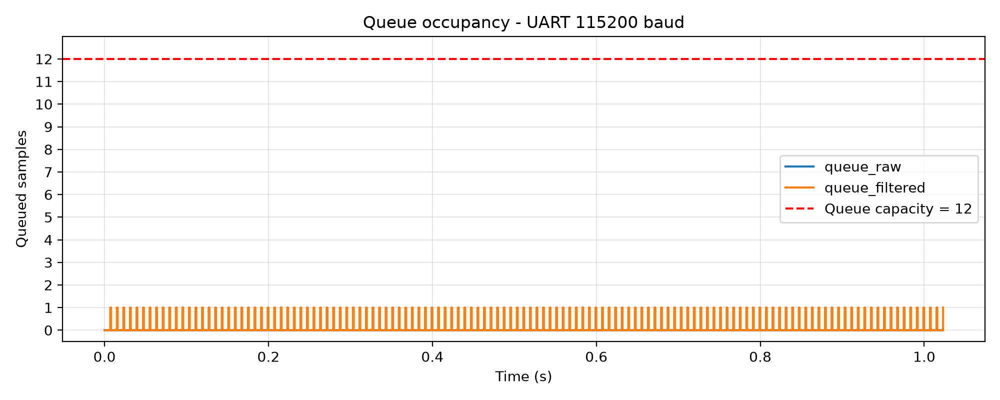
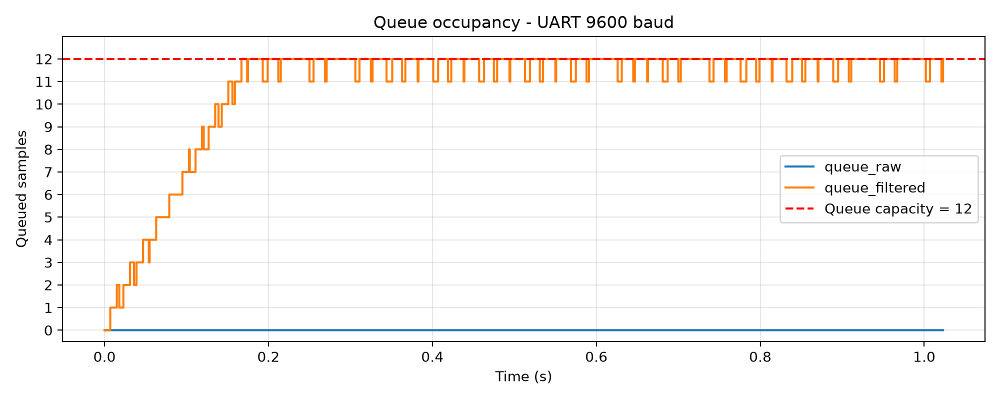
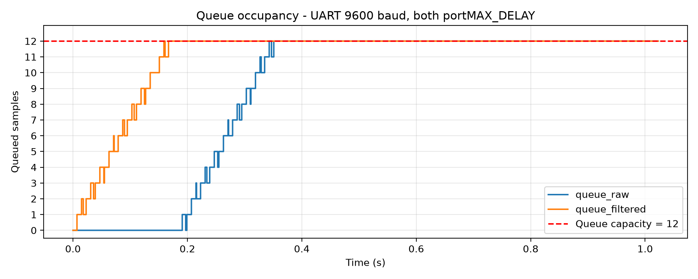

# Report — Week 2 / Ex1

`student_id`: 2510379    Commit của PREDICTION.md: cbdef00

## 1. Kích thước queue tối thiểu
| | Dự đoán | Đo được | Khớp? |
|---|---|---|---|
| `queue_raw` | 1 | 1 | Khớp |
| `queue_filtered` | 1 | 1 | Khớp |

Nếu lệch: nguyên nhân (thời gian xử lý thực tế khác ước lượng, jitter I2C, ...).

**Trả lời:**
- Ở cấu hình UART 115200 baud, chu kỳ lấy mẫu 8 ms và timeout gửi bằng 0, em thử giảm độ dài cả hai queue xuống 1 phần tử. Trong lần thử 30 giây, dữ liệu UART có số thứ tự liên tục; các bộ đếm lỗi I2C, lỗi UART và gửi queue thất bại em xem bằng debug đều bằng 0.
- Kết quả phù hợp với dự đoán: thời gian đọc, lọc và truyền một mẫu nhỏ hơn khoảng cách 8 ms giữa hai lần lấy mẫu, nên dữ liệu không tích tụ qua các chu kỳ.
## 2. Đồ thị độ đầy queue theo thời gian
- Timeout: 0
    + Cấu hình bình thường: 
    + Cấu hình UART chậm (9600 baud): 
- Timeout: portMAX_DELAY
    + Cấu hình bình thường: tương tự với timeout = 0.
    + Cấu hình UART chậm (9600 baud): 
Giải thích hình dạng đồ thị ở mỗi cấu hình.
**Trả lời:**
- Cấu hình bình thường — UART 115200 baud
    + queue_raw được ghi nhận ở mức 0 trong toàn bộ khoảng đo vì filter nhận mẫu nhanh sau khi sensor gửi. Queue vẫn được sử dụng, nhưng logger lấy mẫu mỗi 20 ms có thể bỏ lỡ khoảng thời gian rất ngắn queue chứa dữ liệu.
    + queue_filtered dao động giữa 0 và 1 phần tử: filter gửi mẫu làm độ đầy tăng lên 1; UART nhận mẫu thì độ đầy trở về 0. UART truyền kịp trước khi các mẫu tiếp theo tích tụ nên đồ thị không tăng dần.
    + Hai queue đều cách xa giới hạn 12 phần tử, phù hợp với dự đoán hệ thống xử lý kịp ở cấu hình bình thường.
- Cấu hình UART chậm — 9600 baud (timeout = 0):
    + queue_filtered chủ yếu duy trì ở mức đầy. Nguyên nhân là UART truyền chậm hơn tốc độ filter đưa mẫu vào (được tính khoảng 34.375 ms), khiến dữ liệu tồn đọng.
    + Những lần giảm từ 12 xuống 11 xảy ra khi UART lấy một mẫu ra. Filter sau đó gửi thêm mẫu vào chỗ trống nên queue nhanh chóng đầy lại.
    + queue_raw vẫn được ghi nhận ở mức 0, phù hợp với cấu hình filter gửi bằng timeout 0: khi queue_filtered đầy, filter gửi thất bại và bỏ mẫu đầu ra, rồi tiếp tục nhận mẫu từ queue_raw. Vì vậy, tình trạng đầy không lan ngược về queue raw. 
- Cấu hình UART chậm — 9600 baud (timeout = portMAX_DELAY)
    + Ở UART 9600 baud, khi cả hai lệnh xQueueSend() dùng portMAX_DELAY, queue_filtered tăng dần và đạt 12 phần tử lần đầu vào khoảng 0,16 s. UART truyền chậm hơn tốc độ mẫu đến nên dữ liệu bị tích tụ.
    + Sau khi queue_filtered đầy, filter_task bị block chờ chỗ trống và không tiếp tục nhận dữ liệu từ queue_raw. Vì vậy, queue_raw bắt đầu tích tụ rõ từ khoảng 0,19s và đạt 12 phần tử vào khoảng 0,35 s.
## 3. Khi nào queue đầy
Mô tả **chính xác** thời điểm `queue_filtered` bắt đầu đầy khi hạ baud, và số
mẫu bị mất/trễ (đếm bằng số thứ tự mẫu gắn trong payload).
**Trả lời:**
- Ở UART 9600 baud, CSV ghi nhận queue_filtered có 11 phần tử tại 166 ms và đạt 12/12 phần tử tại 167 ms tính từ lúc logger bắt đầu.
- Trong đoạn log UART từ seq = 1 đến seq = 199, em nhận được 95 mẫu trên tổng số 199 mẫu theo dãy số thứ tự, tức thiếu 104 mẫu, tương ứng khoảng 52,26%. Khoảng nhảy đầu tiên là 21 → 23, cho thấy mẫu số 22 không tới được phía nhận.
- Kết quả phù hợp với việc UART xử lý chậm hơn tốc độ tạo mẫu. Khi queue_filtered đầy, xQueueSend với timeout bằng 0 gửi thất bại; filter bỏ mẫu đó và tiếp tục xử lý mẫu mới.
- Minh chứng csv: [queue_depth_slow.csv](./queue_depth_slow.csv)
- Minh chứng log UART: [UART.txt](./UART.txt)
## 4. Hành vi 3 kiểu timeout
| Timeout | Kết quả quan sát khi queue đầy |
|---|---|
| 0 | Hàm trả về ngay `errQUEUE_FULL`, không block task. Mẫu mới không được đưa vào queue; nếu không gửi lại thì bị bỏ. Trong lần đo UART 9600 baud, log từ seq 1–199 thiếu 104 mẫu, phù hợp với hiện tượng bỏ mẫu khi gửi thất bại. |
| giá trị hữu hạn | Task chuyển sang Blocked để chờ chỗ trống. Nếu có chỗ và task gửi kịp thì trả về `pdPASS`; nếu hết thời gian chờ mà chưa gửi được thì trả về `errQUEUE_FULL`. Việc chờ có thể làm trễ xử lý hoặc lấy mẫu. |
| `portMAX_DELAY` | Với `INCLUDE_vTaskSuspend = 1`, task chờ không giới hạn khi queue đầy. Nếu filter chờ gửi vào queue_filtered, queue_raw có thể đầy theo và khiến sensor cũng bị Blocked từ đó chu kỳ lấy mẫu 8 ms có thể bị trễ. |

## 5. Lệch so với dự đoán
Mỗi mục lệch + nguyên nhân vật lý.

**Trả lời:**
| Mục | Dự đoán | Kết quả đo | Nhận xét và nguyên nhân |
|---|---|---|---|
| Độ đầy queue_raw ở cấu hình bình thường | Dao động chủ yếu giữa 0 và 1 | Logger ghi nhận toàn 0 | Filter lấy mẫu ra nhanh, khoảng queue chứa một mẫu ngắn nên logger có thể không bắt được. Nguyên nhân là do tốc độ đo không bắt kịp khoảng queue_raw lên 1 vì tốc độ xử lý ở bước filter rất nhanh. |
| Độ đầy queue_filtered ở cấu hình bình thường | Gần 0, không tích tụ lâu dài | Dao động giữa 0 và 1 | Phù hợp dự đoán: filter đưa mẫu vào, UART lấy mẫu ra và truyền kịp tốc độ tạo mẫu. |
| Queue đầy trước khi UART chậm | queue_filtered | queue_filtered đạt 12 phần tử tại 167 ms theo CSV | Phù hợp dự đoán. UART 9600 baud truyền chậm hơn tốc độ mẫu đến nên dữ liệu tích tụ. |
| Mất mẫu khi timeout gửi bằng 0 | Có mẫu bị bỏ khi queue đầy | Trong log seq 1–199, nhận 95 mẫu, thiếu 104 mẫu | Đúng so với dự đoán. |
## 6. Câu hỏi đánh đổi
Với `SAMPLE_PERIOD_MS` của **bạn**, nếu `FILTER_WINDOW` tăng gấp đôi thì độ trễ
từ cảm biến đến UART tăng thêm bao nhiêu ms? Trả lời bằng số từ dữ liệu của bạn,
rồi đo lại để kiểm chứng.

**Trả lời:**
- Với `SAMPLE_PERIOD_MS = 8 ms`, khi `FILTER_WINDOW` tăng từ 8 lên
16 mẫu, độ trễ tín hiệu do bộ lọc trung bình trượt dự đoán tăng
thêm 32 ms.
- Độ trễ tín hiệu được tính:
```
Độ trễ ≈ (FILTER_WINDOW − 1) × SAMPLE_PERIOD_MS / 2
```
| Cửa sổ | Phép tính | Độ trễ dự đoán |
|---|---|---:|
| 8 mẫu | (8 − 1) × 8 / 2 | 28 ms |
| 16 mẫu | (16 − 1) × 8 / 2 | 60 ms |
| Tăng thêm | 60 − 28 | 32 ms |

- FILTER_WINDOW lớn hơn làm mượt tín hiệu tốt hơn nhưng
khiến đầu ra phản ánh sự thay đổi của cảm biến chậm hơn.
- Minh chứng đo lại: [Minh_Chung](./Ketquado.png)
- Nhận xét khi đo kiểm chứng: Khi tăng FILTER_WINDOW từ 8 lên 16 mẫu, độ trễ tín hiệu ước lượng tăng từ 27,980 ms lên 59,271 ms, tức tăng 31,291 ms, gần với dự đoán 32 ms.