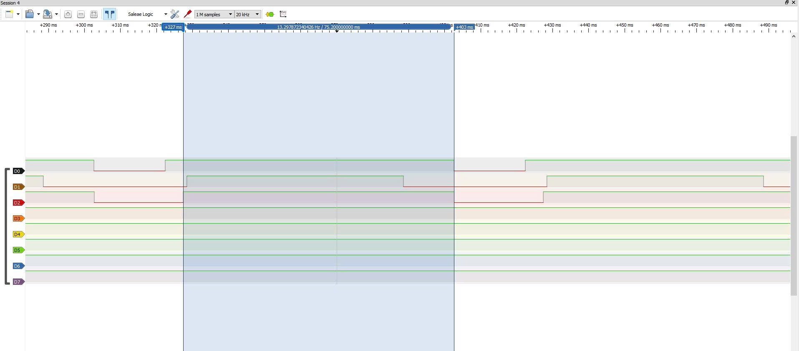

# Report — Week 2 / Ex3

`student_id`: 2510379    Commit của PREDICTION.md: 1184c5b
## 1. Ảnh đo
Binary semaphore: 
Mutex: 

Trên mỗi ảnh, đánh dấu: thời điểm `task_high` sẵn sàng chạy (t0), thời điểm nó
thực sự chạy (t1). Thời gian block = t1 − t0.

## 2. Bảng thời gian block

| Cấu hình | t0 (us) | t1 (us) | Block (us) | Đạt `DEADLINE_MS`? |
|---|---|---|---|---|
| Binary semaphore | 259050 | 304200 | 45150 | Không đạt |
| Mutex | 333350 | 348453 | 15100 | Đạt |

- Minh chứng đạt/không đạt deadline:
    + Binary semaphore: [Binary semaphore](./Images/Deadline_BinarySema.jpg)
    + Mutex: [Mutex](./Images/Deadline_Mutex.jpg)
    
## 3. Vì sao mutex ngắn hơn
Giải thích bằng priority inheritance: `task_low` được nâng lên ưu tiên nào, khi
nào, và việc đó ngăn `task_mid` chen vào như thế nào.

**Trả lời:**
- Low có ưu tiên 1, Mid có ưu tiên 2 và High có ưu tiên 3.
- Khi High yêu cầu mutex đang do Low giữ, High chuyển sang Blocked và Low được kế thừa ưu tiên 3 của High. Vì vậy, khi Mid thức dậy, ưu tiên 2 của Mid thấp hơn ưu tiên hiện tại của Low nên Mid không thể chen vào.
- Low tiếp tục hoàn thành công việc và nhả mutex. Sau đó, Low trở về ưu tiên 1, còn High lấy được mutex để xử lý tài nguyên.
- Với binary semaphore, Low không được nâng ưu tiên nên Mid có thể chen vào khoảng 30 ms, trì hoãn Low nhả khóa. Mutex loại bỏ phần trì hoãn này, giúp thời gian High chờ giảm từ khoảng 45 ms xuống khoảng 15 ms.
## 4. task_mid trong lúc inversion
Mô tả trạng thái kênh `task_mid` trên ảnh binary semaphore trong khoảng
inversion — chạy bao nhiêu lần, mỗi lần bao lâu.

**Trả lời:**
- Trong mỗi lượt inversion ở cấu hình binary semaphore, kênh task_mid (D1) có **một** xung mức cao dài khoảng 30 ms, nằm trong khoảng High chờ khóa (khoảng 45 ms).
- Mid bắt đầu sau khi High bị block khoảng 1 ms. Do Mid có ưu tiên 2, cao hơn Low có ưu tiên 1, Mid chiếm CPU và trì hoãn Low hoàn thành công việc để nhả khóa. Khi Mid kết thúc công việc và chuyển sang Blocked, Low mới tiếp tục phần công việc còn lại rồi nhả khóa cho High.
- Xung D1 đánh dấu khoảng bắt đầu đến kết thúc công việc của Mid.
## 5. Lệch so với dự đoán
Mỗi mục lệch + nguyên nhân vật lý.

| Mục | Dự đoán | Đo được | Độ lệch | Nguyên nhân có thể |
|---|---:|---:|---:|---|
| High chờ khóa — binary semaphore | 45 ms | 45,15 ms | Gần chính xác | Sai lệch có thể đến từ thời gian xử lý ngắt và chi phí chuyển task, sai số của Logic Analyzer |
| High chờ khóa — mutex | 15 ms | 15,1 ms | Gần chính xác | Chi phí Take/Give, chuyển task và GPIO. Sai số trên dây, xung nhịp của Logic Analyzer. |
| Công việc của Mid trong lượt inversion | 1 lượt, 30 ms | 1 lượt, 30.05 ms | Gần chính xác | Thời gian vòng lặp được hiệu chuẩn gần đúng; các ngắt có thể kéo dài thời gian thực tế, cũng như sai số của Logic Analyzer. |

## 6. Câu hỏi đánh đổi
Với bộ tham số của **bạn**, nếu `MID_WORK_MS` tăng gấp đôi thì thời gian block ở
cấu hình binary semaphore tăng thêm bao nhiêu? Trả lời bằng số từ dữ liệu của
bạn, rồi đo lại để kiểm chứng. `task_high` còn đạt `DEADLINE_MS` không?

**Trả lời:**
- Khi MID_WORK_MS tăng từ 30 ms lên 60 ms, Mid chiếm CPU lâu hơn 30 ms. Ở cấu hình binary semaphore, Low không được kế thừa ưu tiên nên phải chờ Mid hoàn thành mới tiếp tục công việc và nhả khóa.
    + Ban đầu: T_block = 15 + 30 = 45 ms.
    + Sau khi tăng: T_block = 15 + 60 = 75 ms.
    + Mức tăng dự đoán: 75 − 45 = 30 ms.
- High không đạt DEADLINE_MS = 20 ms.
- Minh chứng : 