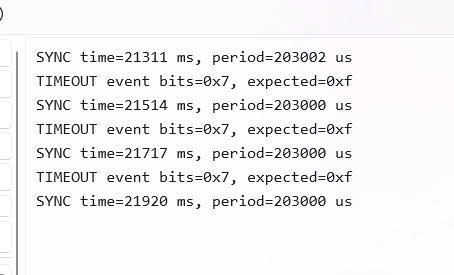

# Report — Week 2 / Ex4

`student_id`: 2510379    Commit của PREDICTION.md: f0bb679

## 1. Bảng so sánh RAM
| | Bytes thực tế | Cách tính |
|---|---|---|
| Event group (4 điểm đồng bộ) | 40 | Đo chênh lệch heap trước và sau xEventGroupCreate(): 40 byte. Cấu trúc event group chiếm 28 byte; phần còn lại là overhead và căn chỉnh cấp phát. |
| Event group (3 điểm) + notification (1 điểm) | 40 | Event group 40 byte, notification không cấp phát thêm |
| Chênh lệch | 0 | Cả hai cấu hình đều cần một event group, có kích thước cấu trúc 28 byte và tiêu thụ thực tế 40 byte heap do overhead và căn chỉnh cấp phát. Giảm số bit sử dụng từ 4 xuống 3 không làm đối tượng nhỏ đi. |

## 2. Bảng so sánh tốc độ đánh thức
| Cách | Thời gian đánh thức (cycle) | Thời gian đánh thức (us) |
|---|---|---|
| Event-group-bit (producer_1 hoặc 2) | 803.15 | 11.15 |
| Task notification (producer_0) | 698.89 | 9.71 |

Mô tả cách đo (2 điểm DWT: lúc gọi set/notify, lúc sync_task bắt đầu chạy):
- Thời gian đánh thức được đo bằng bộ đếm DWT->CYCCNT. Mốc t0 được ghi ngay trước khi producer gọi xEventGroupSetBits() hoặc xTaskNotifyGive(), mốc t1 được ghi ngay sau khi hàm chờ tương ứng trong sync_task trả về thành công. Sync có ưu tiên 3, cao hơn các producer ưu tiên 2. Mỗi cách lấy trung bình 100 mẫu, đường event group chỉ lấy nguồn producer 1 hoặc 2, còn đường notification xóa thông báo tồn đọng trước khi chờ tín hiệu mới. UART được tắt trong lúc thu mẫu. Thời gian tính bằng (uint32_t)(t1 − t0), sau đó chia cho 72 để đổi từ cycle sang µs ở CPU 72 MHz.
## 3. Khi nào KHÔNG dùng được notification
Tình huống bạn dự đoán ở PREDICTION.md, kiểm chứng lại: đúng hay sai, vì sao.

**Trả lời:**
- Không thể thay trực tiếp một lần broadcast của event group bằng một lần task notification khi nhiều task cùng chờ một sự kiện chung. Em kiểm chứng bằng cách tạo hai task A và B, cho cả hai vào trạng thái chờ trước khi phát tín hiệu. Kết quả UART:
```
TEST notify=0, A=1, B=1
TEST notify=1, A=1, B=0
```
- Event group (notify = 0): A và B cùng chờ bit READY_BIT. Một lần gọi xEventGroupSetBits() làm thỏa điều kiện chờ của cả hai, nên cả A và B đều nhận được sự kiện.
- Task notification (notify = 1): chỉ gọi xTaskNotifyGive() cho A. A nhận được thông báo, còn B không được gửi notification nên timeout sau 120 ms.
- Kết quả cho thấy event group hỗ trợ báo một sự kiện chung cho nhiều task đang chờ, trong khi mỗi notification hướng đến một task cụ thể. Muốn đánh thức cả A và B bằng notification phải gửi riêng cho từng task. Vì vậy, đây là trường hợp không thể thay trực tiếp mà giữ nguyên cách báo hiệu

## 4. Timeout
Log/ảnh một lần `sync_task` bị timeout (cố tình làm 1 producer chậm hơn
`SYNC_TIMEOUT_MS`), và giá trị trả về của `xEventGroupWaitBits` lúc đó.

**Trả lời:**
- Em dùng cấu hình event group với 4 producer, giữ `SYNC_TIMEOUT_MS = 120 ms` và tăng khoảng chờ của producer 3 lên 200 ms để cố tình gây timeout.

- Log ghi nhận:
  ```text
  TIMEOUT event bits=0x7, expected=0xf

- xEventGroupWaitBits() trả về 0x7 = 0111: producer 0–2 đã báo, nhưng thiếu bit 3. Vì (0x7 & 0xF) != 0xF, sync xác định chưa nhận đủ các nguồn khi hết thời gian chờ.
- Các dòng SYNC xuất hiện sau đó vì:
    + Timeout chỉ kết thúc lượt chờ hiện tại, không dừng các producer hoặc xóa event group.
    + Các bit 0–2 chưa bị tự động xóa vì điều kiện chờ chưa thỏa mãn.
    + Sync bắt đầu lượt chờ tiếp theo. Khi producer 3 bật bit 3 và đủ 1111, sync đồng bộ thành công.
    + Do producer 3 tiếp tục phát chậm, log xuất hiện các dòng TIMEOUT xen kẽ SYNC.
## 5. Lệch so với dự đoán
Mỗi mục lệch + nguyên nhân vật lý.

**Trả lời:**
- **RAM event group:** Em dự đoán cấu trúc chiếm 28 byte và đo được `sizeof(StaticEventGroup_t) = 28 byte`, khớp dự đoán. Tuy nhiên, chênh lệch heap trước và sau khi tạo là 40 byte. Với `heap_4` và căn chỉnh 8 byte trong cấu hình này, khối cấp phát gồm 28 byte dữ liệu, 8 byte header quản lý và 4 byte căn chỉnh. Vì vậy, 40 byte là lượng heap thực tế tiêu thụ, không phải kích thước riêng của cấu trúc.
- **RAM khi thay một nguồn bằng notification:** Kết quả khớp dự đoán, notification không cấp phát thêm heap vì vùng notification đã nằm trong TCB khi bật `configUSE_TASK_NOTIFICATIONS = 1`. Hai cấu hình đều tiêu thụ 40 byte heap cho một event group; giảm số bit sử dụng từ 4 xuống 3 không làm đối tượng nhỏ đi. Do đó, chênh lệch RAM đo được bằng 0 byte.
- **Tốc độ đánh thức:** Kết quả khớp dự đoán: notification trung bình 698,89 cycle (9,71 µs), thấp hơn event group 803,15 cycle (11,15 µs). Chênh lệch khoảng 104,26 cycle, tương đương 1,45 µs ở 72 MHz. Nguyên nhân phù hợp với đường xử lý: notification cập nhật trực tiếp task nhận, còn event group cần cập nhật bit và kiểm tra điều kiện của các task đang chờ. Các thời gian này còn bao gồm chi phí lập lịch và chuyển ngữ cảnh sang sync.
- **Timeout:** Khớp dự đoán. Khi producer 3 chờ 200 ms, lớn hơn timeout 120 ms, `xEventGroupWaitBits()` trả về `0x7`, cho thấy đã có bit 0–2 nhưng thiếu bit 3. Những dòng `SYNC` xuất hiện sau đó không mâu thuẫn với kết quả timeout: producer 3 cuối cùng vẫn phát sự kiện và giúp lượt chờ tiếp theo đủ điều kiện.
- **Giới hạn thay thế bằng notification:** Khớp dự đoán. Log event group cho kết quả `A=1, B=1`, còn notification gửi riêng cho A cho kết quả `A=1, B=0`. Điều này xác nhận một lần notification không thay trực tiếp được một lần broadcast cho nhiều task; muốn đạt hành vi tương tự phải gửi riêng đến từng task.
## 6. Câu hỏi đánh đổi
Với `EVENT_BIT_COUNT` của **bạn**, nếu tăng thêm 1 bit (1 producer nữa) thì chu
kỳ đồng bộ trung bình đo được thay đổi thế nào? Trả lời bằng số từ dữ liệu của
bạn, rồi đo lại để kiểm chứng.

**Trả lời:**
- Với `EVENT_BIT_COUNT = 4`, chu kỳ đồng bộ trung bình đo được khoảng 4,38 ms. Khi tăng lên 5 producer và giữ nguyên cách phát sự kiện, em dự đoán chu kỳ tăng nhẹ vì sync phải chờ thêm một nguồn.

- Đo kiểm chứng: Em tăng `EVENT_BIT_COUNT` từ 4 lên 5, giữ nguyên ưu tiên và quy tắc phát sự kiện, tắt UART trong lúc thu mẫu. Mỗi cấu hình lấy trung bình 100 khoảng chu kỳ bằng DWT. Em đo cả chế độ event group và chế độ thay producer 0 bằng notification.

| Cấu hình | 4 producer (ms) | 5 producer (ms) | Mức tăng (ms) |
|---|---:|---:|---:|
| Event group | 4,37980 | 4,62978 | 0,24998 |
| Event group + notification | 4,37977 | 4,62975 | 0,24997 |

- Nhận xét: Trong cả hai cấu hình, chu kỳ trung bình tăng khoảng 0,25 ms, tương đương 5,71%, phù hợp với dự đoán tăng nhẹ. Hai chế độ cho kết quả gần nhau trong phép thử này vì chu kỳ chủ yếu phụ thuộc thời điểm các nguồn phát đủ sự kiện, còn chênh lệch thời gian đánh thức giữa hai API nhỏ hơn nhiều.