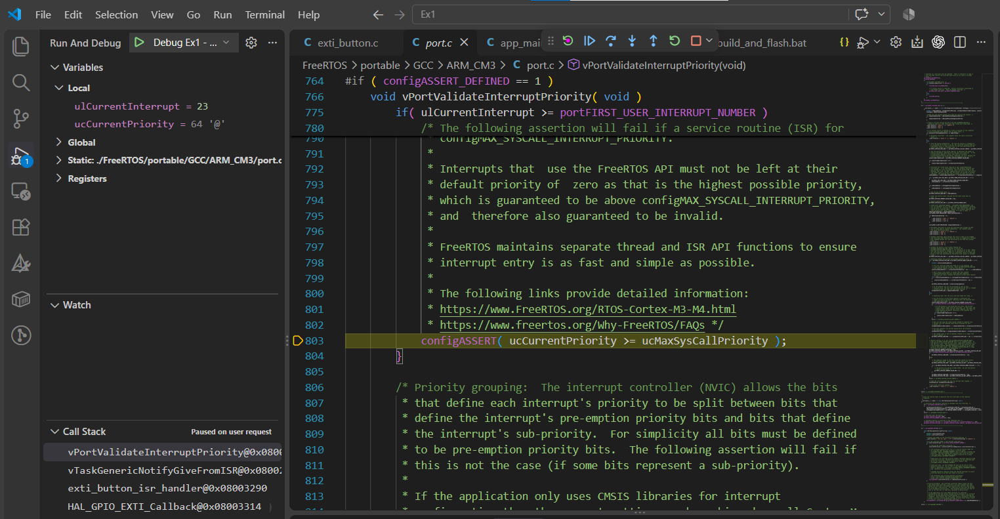
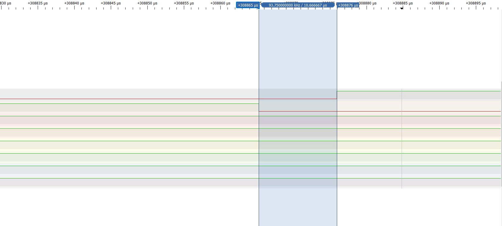
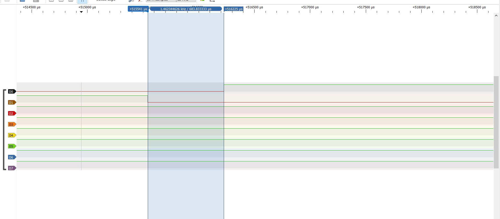
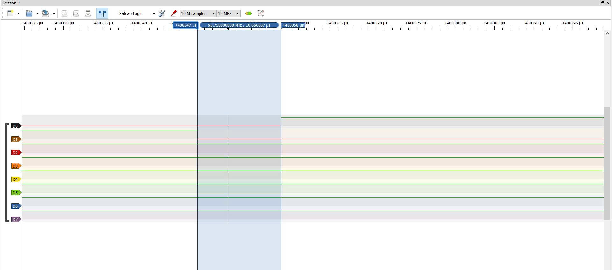
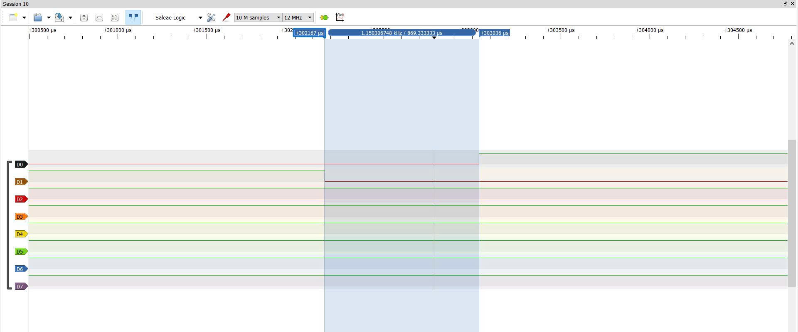

# Report — Week 3 / Ex1

`student_id`: 2510379    Commit của PREDICTION.md: 22f84cb

## 1. Bằng chứng configASSERT
Mô tả/log/ảnh lúc priority sai (bước 4 README) + giải thích chính xác **vì sao**
assert được kích hoạt (nêu đúng tên macro và điều kiện).

**Trả lời:**

- Mô tả trạng thái khi đặt priority sai:
    - Em đặt priority EXTI1 bằng 4 qua lệnh `HAL_NVIC_SetPriority(EXTI1_IRQn, 4, 0)`. Khi nhấn PB1, cạnh xuống kích hoạt ngắt và chương trình đi theo chuỗi: `EXTI1_IRQHandler()`, `HAL_GPIO_EXTI_IRQHandler()`, `HAL_GPIO_EXTI_Callback()`, `exti_button_isr_handler()`, `vTaskGenericNotifyGiveFromISR()`, `vPortValidateInterruptPriority()`.
    - Khi Pause bằng debugger, CPU đang bị giữ tại dòng `configASSERT(ucCurrentPriority >= ucMaxSysCallPriority)` trong `port.c`. Giá trị quan sát được là `ucCurrentPriority = 64` (`0x40`); ngưỡng syscall tương ứng là `ucMaxSysCallPriority = 80` (`0x50`).
    - Khi điều kiện sai, macro `configASSERT` gọi `taskDISABLE_INTERRUPTS()` rồi lặp vô hạn. Chương trình không tiếp tục đánh thức `ack_task` để đảo PA6.

- Giải thích nguyên nhân kích hoạt assert:
    - `vTaskNotifyGiveFromISR()` là macro gọi `vTaskGenericNotifyGiveFromISR()`. Hàm này sử dụng macro `portASSERT_IF_INTERRUPT_PRIORITY_INVALID()` để gọi `vPortValidateInterruptPriority()`, kiểm tra ISR hiện tại có được phép sử dụng API FreeRTOS hay không.
    - Với `configPRIO_BITS = 4`, macro `configMAX_SYSCALL_INTERRUPT_PRIORITY` được tính từ `configLIBRARY_MAX_SYSCALL_INTERRUPT_PRIORITY = 5` bằng phép dịch `5 << (8 - 4) = 80`. Priority EXTI1 bằng 4 được biểu diễn trong thanh ghi NVIC là `4 << 4 = 64`.
    - Điều kiện `ucCurrentPriority >= ucMaxSysCallPriority` trở thành `64 >= 80`, cho kết quả sai nên kích hoạt `configASSERT`.
    - Số priority NVIC càng nhỏ thì ưu tiên phần cứng càng cao. EXTI1 mức 4 không bị che khi kernel dùng `BASEPRI` để bảo vệ dữ liệu trước các ngắt mức 5–15. Nếu ngắt này gọi API FreeRTOS, nó có thể chen vào lúc kernel đang cập nhật dữ liệu quản lý task. Vì vậy, FreeRTOS bắt vi phạm ngay tại bước kiểm tra priority.
## 2. Latency ISR → task
| Cấu hình | Dự đoán (us) | Đo được (us) | Đạt `LATENCY_BUDGET_US`? |
|---|---|---|---|
| Có `portYIELD_FROM_ISR` | 10 | 10.667 | Đạt |
| Không có `portYIELD_FROM_ISR` | 510 | 683.833 | Không đạt |

Ảnh logic analyzer đính kèm cho cả 2 cấu hình.

## 3. Giải thích quan hệ priority
Giải thích bằng lời của bạn: số NVIC priority nhỏ/lớn nghĩa là gì, vì sao
`configLIBRARY_MAX_SYSCALL_INTERRUPT_PRIORITY` tồn tại, điều gì xảy ra nếu một
ISR ưu tiên cao hơn ngưỡng này gọi API FreeRTOS.

**Trả lời:**
- Trên STM32F103, với `configPRIO_BITS = 4` và `NVIC_PRIORITYGROUP_4`, có 16 mức ưu tiên ngắt từ 0 đến 15. Số càng nhỏ thì ưu tiên phần cứng càng cao: mức 0 cao nhất, mức 15 thấp nhất. Ví dụ, ngắt mức 4 có thể ngắt ngang ngắt mức 6 nếu không bị che. Khi lưu vào thanh ghi NVIC, priority được dịch trái 4 bit; mức 5 tương ứng `5 << 4 = 0x50`.
- `configLIBRARY_MAX_SYSCALL_INTERRUPT_PRIORITY = 5` quy định ngưỡng ưu tiên được phép gọi các API FreeRTOS `FromISR`: ngắt mức 5–15 được phép gọi, còn mức 0–4 không được phép. Khi cập nhật dữ liệu quan trọng, kernel vào vùng găng (critical section) và dùng `BASEPRI = 0x50` để tạm che các ngắt mức 5–15. Vùng được bảo vệ là đoạn code đang sửa cấu trúc dữ liệu dùng chung, chẳng hạn danh sách task Ready, danh sách task chờ sự kiện và dữ liệu quản lý queue. Một thao tác có thể cần nhiều lệnh để cập nhật các con trỏ, bộ đếm và trạng thái task; phải tránh ISR cùng truy cập khi việc cập nhật chưa hoàn tất. Các ngắt mức 0–4 vẫn có thể chạy để phục vụ sự kiện khẩn cấp, nhưng không được gọi API FreeRTOS.
- Nếu ISR mức 0–4 gọi API FreeRTOS, nó có thể chen vào giữa quá trình kernel cập nhật dữ liệu và tiếp tục sửa chính dữ liệu đó. Ví dụ, kernel đang sửa liên kết của danh sách task nhưng chưa cập nhật xong, ISR lại đánh thức một task và thay đổi danh sách. Khi quay về, kernel tiếp tục dùng các giá trị cũ, có thể làm mất liên kết, sai bộ đếm hoặc đưa task vào trạng thái không nhất quán. Hậu quả có thể là task Ready không được chạy, task chờ không được đánh thức, chương trình mắc trong vòng duyệt danh sách hoặc HardFault do truy cập địa chỉ không hợp lệ. 
## 4. Lệch so với dự đoán
Mỗi mục lệch + nguyên nhân vật lý (jitter NVIC, pipeline, v.v.).

**Trả lời:**
- Có `portYIELD_FROM_ISR`: dự đoán khoảng 10 µs, đo được 10,5833 µs, cao hơn khoảng `0,5833 µs`. Dự đoán chỉ ước lượng số chu kỳ CPU, chưa tính chính xác chi phí xử lý HAL, notification, lưu/khôi phục ngữ cảnh và truy cập Flash. Ngắt khác có thể làm xuất hiện jitter, độ phân giải khi dùng logic analyzer cũng góp phần vào sai lệch này.
- Không có `portYIELD_FROM_ISR`: dự đoán tăng khoảng 0-1000 µs, đo được 683,8333 µs ,nằm trong khoảng dự kiến khi cộng cả thời gian xử lý cơ bản. Nếu lấy dự đoán trung bình là 510 µs thì kết quả cao hơn 173,8333 µs. Nguyên nhân chính là thời điểm nhấn nút không nằm đúng giữa hai tick; thời gian chờ phụ thuộc pha của cạnh nút so với SysTick, không phải luôn bằng nửa tick.
- Chênh lệch giữa hai cấu hình: bỏ yield làm latency tăng `673,25 µs` trong hai lần đo này. Kết quả phù hợp với việc phải chờ thêm một phần chu kỳ tick 1000 µs; mức tăng không cố định cho mọi lần nhấn.
## 5. Câu hỏi đánh đổi
Nếu tăng `ISR_NVIC_PRIO` của bạn lên một bậc (ưu tiên thấp hơn) trong khi vẫn
hợp lệ, latency đo được thay đổi bao nhiêu? Trả lời bằng số đo thật, không
đoán.

**Trả lời:**
- Em tăng priority EXTI1 từ 6 lên 7, vẫn hợp lệ vì `5 <= 7 <= 15`, và trong bài cũng không tạo thêm ngắt cạnh tranh nên kết quả đo sẽ không lệch nhiều so với lúc chưa tăng. Kết quả đo:

| Cấu hình | Priority 6 (µs) | Priority 7 (µs) | Chênh lệch (µs) |
|---|---:|---:|---:|
| Có yield | 10,5833 | 10,6667 | +0,0834 |
| Không yield | 683,8333 | 869,3333 | +185,5000 |

- Khi có `portYIELD_FROM_ISR`, latency gần như không đổi; chênh lệch khoảng 0,0833 µs tương đương một bước lấy mẫu ở 12 MHz. Priority thấp hơn không làm ISR thực thi chậm hơn, mà chỉ thay đổi khả năng tranh quyền với các ngắt khác.
- Khi không có `portYIELD_FROM_ISR`, latency tăng 185,5 µs giữa hai lần đo. Tuy nhiên, không thể quy mức tăng này riêng cho việc đổi priority, vì thời gian chờ đến tick tiếp theo phụ thuộc thời điểm nhấn nút.

