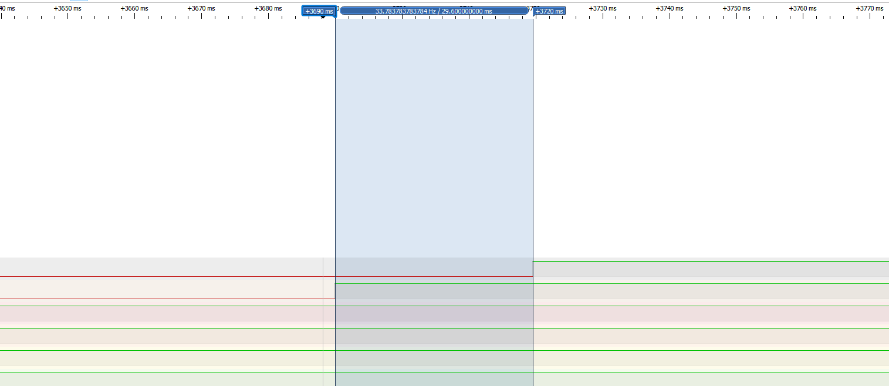
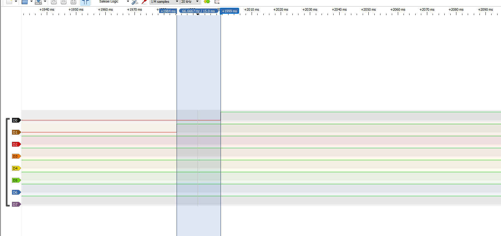
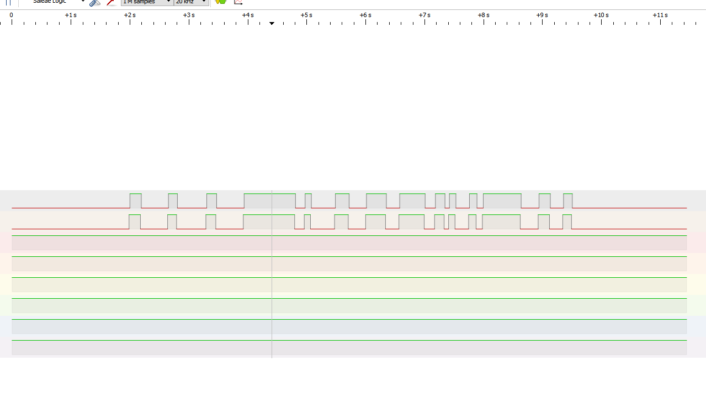

# Report — Week 3 / Ex2

`student_id`: 2510379    Commit của PREDICTION.md: 7741a51

## 1. Nảy phím trước/sau
Ảnh logic analyzer: tín hiệu thô (nhiều cạnh nảy) và tín hiệu "PRESS" sau khi
qua `debounce_timer` (một cạnh sạch).

**Trả lời:**



| Kênh | Chân STM32 | Tín hiệu |
|---|---|---|
| **D1 — đường dưới** | **PB1** | Tín hiệu thô từ nút nhấn. D1 chuyển từ LOW sang HIGH khi nhấn nút. |
| **D0 — đường trên** | **PA6** | Tín hiệu sau debounce. D0 chuyển từ LOW sang HIGH khi callback của `debounce_timer` xác nhận trạng thái nhấn (`PRESS`). |

- Hai con trỏ được đặt tại cạnh lên của D1 và cạnh lên của D0. Độ trễ đo được là **29,6 ms**, gần với giá trị cấu hình `DEBOUNCE_MS = 30 ms`.

## 2. Callback bị block — thí nghiệm bước 4

Cấu hình thử nghiệm giữ `DEBOUNCE_MS = 30 ms` và `LONGPRESS_MS = 600 ms`. Trong `debounce_callback()`, lệnh `vTaskDelay(pdMS_TO_TICKS(50))` được đặt ngay sau khi ghi `PRESS`.

| Nội dung | Dự đoán | Đo được |
|---|---|---|
| Độ trễ tăng thêm của `longpress_callback` khi `debounce_callback` block 50 ms | Khoảng **0 ms** trong lần nhấn giữ này. Daemon dự kiến bị block trong khoảng **30–80 ms** sau cạnh nhấn cuối, còn `HELD` đầu tiên đến hạn ở khoảng **600 ms**. | `HELD` đầu tiên xuất hiện **570 ms sau `PRESS`**, phù hợp với mốc dự kiến `600 − 30 = 570 ms`. Các lần `HELD` tiếp theo cách nhau **600 ms**. |

### Log UART và phân tích

Timestamp được lấy bằng `xTaskGetTickCount()`. Với tick rate 1000 Hz, mỗi tick tương ứng 1 ms.

```text
PRESS 2379
HELD 2949
HELD 3549
HELD 4149
HELD 4749
HELD 5349
HELD 5949
HELD 6549
HELD 7149
HELD 7749
HELD 8349
```

- Từ `PRESS` đến `HELD` đầu tiên: `2949 − 2379 = 570` tick, tương ứng **570 ms**. Timer long-press bắt đầu từ cạnh nhấn trong ISR, còn `PRESS` được ghi sau cửa sổ debounce khoảng 30 ms.
- Từ `HELD` đầu tiên đến `HELD` kế tiếp: `3549 − 2949 = 600` tick, tương ứng **600 ms**. Các mốc còn lại cũng cách nhau 600 ms.
- Hai callback chạy trên cùng timer daemon task. Khi `debounce_callback()` gọi `vTaskDelay()`, daemon tạm dừng xử lý callback và các lệnh timer trong queue. Nếu `longpress_callback` đến hạn trong khoảng đó, nó phải đợi daemon chạy lại. Với số liệu trong bài hiện tại, hạn `HELD` nằm ngoài khoảng block dự kiến nên sẽ không ảnh hưởng đến thời gian gọi callback để in `PRESS`.


## 3. Giải thích daemon task
Giải thích **bằng cơ chế**, không chỉ hiện tượng: vì sao một callback block sẽ
ảnh hưởng timer khác, liên hệ đến timer command queue và việc có đúng MỘT
daemon task xử lý tất cả software timer.

**Trả lời:**
- **Một daemon task chạy tất cả callback.** Khi `configUSE_TIMERS = 1`, FreeRTOS tạo một timer daemon task lúc scheduler khởi động. Hai timer được tạo bằng `xTimerCreate()` có chu kỳ và callback riêng. Cả `debounce_callback()` và `longpress_callback()` đều chạy lần lượt trên cùng daemon task.
- **ISR gửi lệnh qua timer command queue.** Mỗi cạnh trên PB1 gọi `xTimerResetFromISR()` để đặt lại hạn debounce. Cạnh lên gọi `xTimerStartFromISR()` để bắt đầu long-press, còn cạnh xuống gọi `xTimerStopFromISR()` để dừng. `pdPASS` xác nhận lệnh đã vào queue. Daemon xử lý các lệnh này và trực tiếp gọi callback khi timer đến hạn.
- **Một callback block khiến các timer khác phải chờ.** Khi `debounce_callback()` gọi `vTaskDelay(pdMS_TO_TICKS(50))`, chính daemon task bị block. Tick hệ thống vẫn tăng và ISR vẫn có thể gửi lệnh nếu queue còn chỗ. Daemon chỉ tiếp tục xử lý lệnh và gọi callback của timer đã đến hạn sau khi được lập lịch chạy lại và `debounce_callback()` trả về. Nếu nhiều cạnh EXTI tiếp tục gửi lệnh trong lúc daemon bị block, timer command queue có thể đầy. Khi đó, API `...FromISR()` trả về `pdFAIL` và lệnh vừa gửi không được đưa vào queue.
## 4. Long-press
Thời gian giữ thực tế đo được so với `LONGPRESS_MS`: khớp không?

**Trả lời:**
- Lần phát hiện long-press đầu tiên. Log ghi `PRESS` tại tick 2379. Với cửa sổ debounce danh định 30 tick, cạnh nhấn cuối được ước tính tại tick `2379 − 30 = 2349`. `HELD` đầu tiên xuất hiện tại tick 2949, tức khoảng `2949 − 2349 = 600` tick sau cạnh nhấn cuối. Ở tick rate 1000 Hz, kết quả tương ứng khoảng **600 ms**, khớp với `LONGPRESS_MS = 600 ms`.
- Chu kỳ lặp khi tiếp tục giữ. Các mốc `HELD 2949`, `HELD 3549` và `HELD 4149` cách nhau đúng **600 tick**, tương ứng **600 ms**, phù hợp với chế độ auto-reload.

```text
PRESS 2379
HELD 2949
HELD 3549
HELD 4149
HELD 4749
HELD 5349
HELD 5949
HELD 6549
HELD 7149
HELD 7749
HELD 8349
```
## 5. Lệch so với dự đoán
Mỗi mục lệch + nguyên nhân.

**Trả lời:**
- **Thời gian debounce lệch 0,4 ms so với giá trị cấu hình.** Logic analyzer ghi nhận độ trễ từ cạnh lên của D1 (PB1) đến cạnh lên của D0 (PA6) là **29,6 ms**, thấp hơn `DEBOUNCE_MS = 30 ms` khoảng **0,4 ms**. Mức chênh này phù hợp với độ phân giải tick của FreeRTOS. Với `configTICK_RATE_HZ = 1000`, mỗi tick dài **1 ms**, còn cạnh nhấn có thể xuất hiện giữa hai tick. `xTimerResetFromISR()` lấy tick hiện tại để xác định hạn mới, nên thời gian đo bằng logic analyzer có thể ngắn hơn chu kỳ danh định một phần tick.

- **Khoảng từ `PRESS` đến `HELD` là 570 ms, phù hợp với ngưỡng long-press 600 ms.** Log ghi `PRESS 2379` và `HELD 2949`, chênh **570 tick**, tương ứng **570 ms**. Nguyên nhân là `xTimerStartFromISR()` khởi động long-press ngay tại cạnh nhấn, còn `PRESS` được ghi sau cửa sổ debounce 30 ms. Vì vậy, khoảng cách giữa hai log tương ứng `600 − 30 = 570 ms`. Các lần `HELD` tiếp theo tại tick **3549, 4149, 4749** cũng cách nhau đúng **600 ms**, phù hợp với chu kỳ auto-reload.

- **Chèn delay 50 ms không làm thay đổi khoảng thời gian quan sát được của long-press trong lần thử này.** Kết quả khớp với dự đoán ban đầu: `PRESS` đến `HELD` vẫn cách nhau **570 ms**, các lần `HELD` liên tiếp cách nhau **600 ms**. Trong code, `vTaskDelay(pdMS_TO_TICKS(50))` nằm sau đoạn ghi `PRESS`, nên daemon bắt đầu chờ sau khi debounce đã xác nhận nút nhấn. Khoảng chờ này kết thúc trước hạn long-press 600 ms, cho phép daemon xử lý `HELD` đúng chu kỳ. Do timestamp `PRESS` được lấy trước delay, giá trị log này cũng không bị dời thêm 50 ms.

## 6. Câu hỏi đánh đổi
Với `DEBOUNCE_MS` của bạn, nếu giảm xuống còn một nửa thì tín hiệu sau debounce
còn sạch không? Đo lại trên board của bạn, không suy luận suông.

**Trả lời:**
## 6. Câu hỏi đánh đổi

Em giảm `DEBOUNCE_MS` từ **30 ms xuống 15 ms**, giữ `LONGPRESS_MS = 600 ms`, sau đó nạp lại chương trình và đo trên board.

**Kết quả trên logic analyzer**





| Kênh | Chân STM32 | Quan sát trên ảnh phóng to |
|---|---|---|
| **D1** | **PB1** | Tín hiệu nút thô chuyển từ LOW sang HIGH tại khoảng **1984 ms**. |
| **D0** | **PA6** | Tín hiệu sau debounce chuyển từ LOW sang HIGH tại khoảng **1999 ms**. |

Hai con trỏ đo được khoảng cách **15,0 ms** giữa cạnh lên của D1 và cạnh lên của D0, khớp với cửa sổ debounce đã giảm. Trong khoảng chờ này, D0 giữ LOW. Sau khi xác nhận trạng thái nhấn, D0 tạo **một cạnh lên duy nhất** và giữ HIGH trong phần tín hiệu đang hiển thị.

Trên ảnh tổng quan, D1 có **14 xung nhấn** và D0 có **14 xung tương ứng**. Trong phạm vi quan sát, D0 không xuất hiện thêm xung ngắn hoặc bị tách thành nhiều xung trong một khoảng giữ HIGH của D1. Đây là dấu hiệu cho thấy đầu ra vẫn ổn định trong chuỗi thao tác đã thử.

**Đối chiếu với log UART**

```text
PRESS 4738
PRESS 5392
PRESS 6041
PRESS 6676
HELD 7261
PRESS 7710
PRESS 8224
PRESS 8751
PRESS 9315
PRESS 9920
PRESS 10158
PRESS 10498
PRESS 10732
HELD 11317
PRESS 11678
PRESS 12094
```

Log có **14 dòng `PRESS`**, phù hợp với số xung quan sát trên ảnh tổng quan. Hai lần nhấn giữ ghi nhận:

- `PRESS 6676` → `HELD 7261`, chênh **585 tick**.
- `PRESS 10732` → `HELD 11317`, chênh **585 tick**.

Với tick rate **1000 Hz**, hai khoảng này đều bằng **585 ms**, phù hợp với `600 − 15 = 585 ms`. Long-press bắt đầu tính thời gian từ ISR, còn `PRESS` xuất hiện sau khi debounce xác nhận nút.

**Kết luận đánh đổi**

- Khi giảm `DEBOUNCE_MS` xuống **15 ms**, tín hiệu sau debounce vẫn sạch trong các lần nhấn–nhả đã đo. Mỗi cạnh nảy mới gọi `xTimerResetFromISR()` để đặt lại hạn thành 15 ms kể từ cạnh đó. Cửa sổ này đủ để xác nhận trạng thái ổn định trong chuỗi thử nghiệm, đồng thời giảm độ trễ đo được từ **29,6 ms xuống 15,0 ms**.

- Đổi lại, cửa sổ ngắn hơn làm giảm khả năng loại bỏ những đợt nảy có khoảng yên đủ dài để bị nhận thành trạng thái ổn định. Với kết quả đã ghi nhận, 15 ms là mức phù hợp với nút trên board trong điều kiện đã thử, vừa giảm thời gian phản hồi vừa duy trì đầu ra sạch.