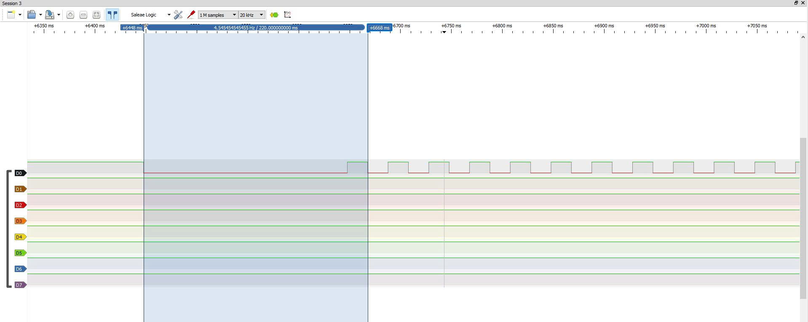
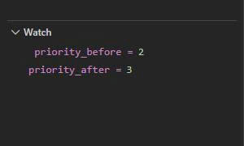
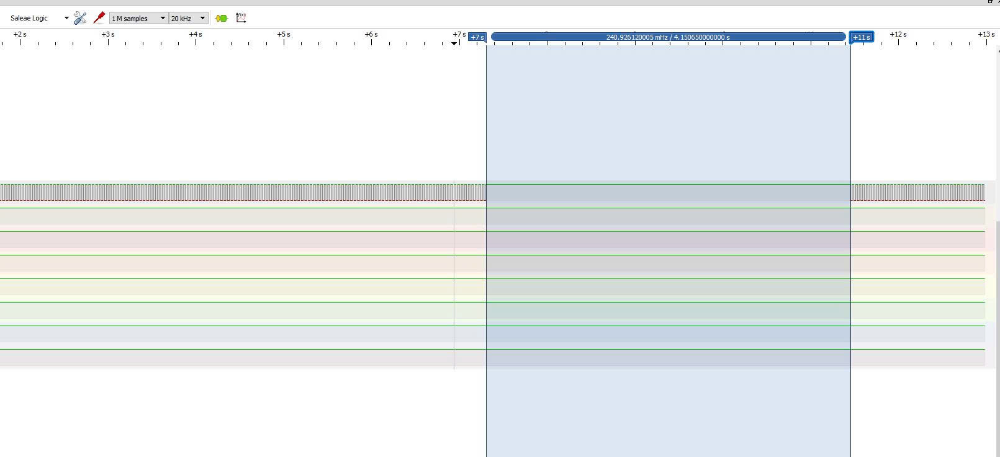
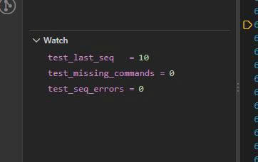
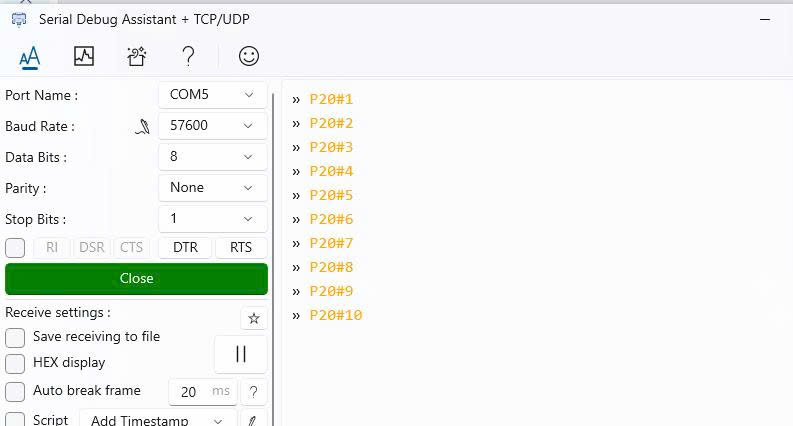
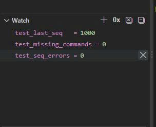
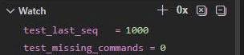

# Report — Week 3 / Ex3

`student_id`: 2510379    Commit của PREDICTION.md: 33f42ef

## 1. Thời gian byte & độ sâu stream buffer
Phép tính thời gian 1 byte ở `RX_BAUD`, và số lệnh tối đa chứa được trong
`STREAM_BUFFER_BYTES`.

**Trả lời:**
- Với RX_BAUD = 57600 baud và cấu hình 8N1, mỗi byte dữ liệu được truyền bằng 10 bit: 1 bit start, 8 bit dữ liệu và 1 bit stop.
- Thời gian truyền một byte: T_byte = 10 / 57600 × 10^6 ≈ 173,61 µs.
- STREAM_BUFFER_BYTES = 192 byte. Với mỗi lệnh dài tổng cộng MAX_CMD_LEN = 16 byte, số lệnh tối đa chứa được khi parser chưa đọc dữ liệu ra là: N = floor(192 / 16) = 12 lệnh.
- Sau 12 lệnh như trên, buffer đầy. Byte tiếp theo sẽ không được lưu nếu parser chưa lấy dữ liệu ra để giải phóng chỗ trống.
## 2. Demo 3 loại lệnh
Bằng chứng (log/ảnh) `demo_task` phản ứng đúng với `P`, `S`, `T` — mỗi loại ít
nhất 1 ví dụ có số liệu trước/sau.

**Trả lời:**
| Loại lệnh | Lệnh gửi | Trước khi gửi | Sau khi gửi |
|---|---|---|---|
| P | P20 | Khoảng cách hai cạnh PA6: 200 ms | Khoảng cách hai cạnh PA6: 20 ms |
| S | S3 | Priority demo_task = 2 | Priority đọc lại bằng uxTaskPriorityGet = 3 |
| T | T0, sau đó T1 + CR | PA6 toggle khoảng mỗi 20 ms | Ngừng toggle trong 4.1 s, sau đó tiếp tục khoảng mỗi 20 ms |

- Minh chứng lệnh P20:

- Minh chứng lệnh S3

- Minh chứng lệnh T0, T1:

## 3. Test gửi nhanh
| | Số lệnh gửi | Số lệnh nhận đúng | Mất/lỗi |
|---|---|---|---|
| Gõ tay bình thường | 10 | 10 | 0 |
| Gửi liên tục (script) | 1000 | 1000 | 0 |

Nếu có mất byte: giải thích bằng cơ chế (stream buffer đầy, parser bị trễ,
hay nguyên nhân khác) — không chỉ nói "bị mất".

**Trả lời:**
- Minh chứng gửi bằng cách gõ tay:

- Lệnh gửi bằng script: `py .\test_uart.py`

- Giả sử nếu có mất byte khi gửi liên tục, có thể giải thích theo các cơ chế sau:
    - Stream buffer đầy: Dữ liệu đến nhanh hơn tốc độ parser lấy ra, làm buffer hết chỗ. Khi đó, xStreamBufferSendFromISR() trả về 0, byte mới bị bỏ và xảy ra việc mất dữ liệu gửi vào.
    - Parser bị trễ: Parser có thể bị task hoặc ISR ưu tiên cao hơn chiếm CPU nên chưa lấy dữ liệu ra kịp. Buffer giúp giữ dữ liệu tạm thời; parser bị trễ chỉ gây mất byte khi buffer đã đầy mà dữ liệu vẫn tiếp tục đến.
    - UART bị overrun: ISR không đọc dữ liệu nhận kịp trước khi byte tiếp theo đến, khiến phần cứng UART báo lỗi ORE. Byte bị mất trước khi vào stream buffer.
    - Nguyên nhân khác: Bật lại nhận bằng HAL_UART_Receive_IT() thất bại, sai baudrate hoặc nhiễu đường truyền cũng có thể làm gián đoạn hoặc sai dữ liệu.
## 4. Vì sao stream buffer, không phải queue
Giải thích bằng lời của bạn.

**Trả lời:**
- UART RX cung cấp luồng byte liên tiếp, còn lệnh có độ dài khác nhau và kết thúc bằng `\r`. Stream buffer phù hợp để ISR đưa byte vào, còn parser đọc và ghép thành lệnh.
- Queue vẫn có thể chứa từng byte, nhưng được tổ chức theo phần tử có kích thước cố định. Stream buffer hỗ trợ gửi/nhận số byte thay đổi và phù hợp với mô hình một bên ghi là UART ISR, một bên đọc là parser task.
- Về RAM, nếu queue chứa từng byte thì vùng dữ liệu gần tương đương stream buffer cùng dung lượng; khác biệt chủ yếu nằm ở phần quản lý. Nếu queue dành một ô cố định cho cả lệnh, lệnh ngắn vẫn chiếm toàn bộ ô, trong khi stream buffer lưu theo số byte thực tế.
## 5. Lệch so với dự đoán
Mỗi mục lệch + nguyên nhân.

**Trả lời:**
- Thời gian truyền một byte và khả năng xử lý của parser — phù hợp dự đoán: Với UART 8N1 ở 57600 baud, thời gian truyền một byte khoảng 173,61 µs. Kết quả nhận đủ lệnh cho thấy parser vẫn đáp ứng được tốc độ dữ liệu trong điều kiện thử nghiệm. Parser có ưu tiên cao, chủ yếu đọc byte, kiểm tra và ghép lệnh nên lượng xử lý tương đối nhỏ.
- Gõ tay bình thường — phù hợp dự đoán: Không ghi nhận mất lệnh. Khoảng nghỉ giữa các lần gửi đủ lớn để parser xử lý dữ liệu, nên dữ liệu không tích tụ đến mức làm đầy stream buffer.
- Gửi liên tục bằng script ở 57600 baud — phù hợp dự đoán: Hệ thống nhận đủ số lệnh đã gửi. Mặc dù script gửi liên tục không chèn thời gian nghỉ, dữ liệu vẫn được truyền theo baudrate UART. Parser lấy dữ liệu ra đủ nhanh nên không ghi nhận mất/lỗi lệnh trong lượt thử.
## 6. Câu hỏi đánh đổi
Với `RX_BAUD` của bạn, nếu tăng gấp đôi `STREAM_BUFFER_BYTES`, tốc độ gửi tối
đa không mất byte tăng thêm bao nhiêu (đo thật, không suy luận)?

**Trả lời:**

- Với `STREAM_BUFFER_BYTES = 192 byte`, gửi liên tục **1000 lệnh bằng script**, hệ thống nhận đúng **1000/1000 lệnh**, không ghi nhận mất dữ liệu.
- Sau khi tăng gấp đôi buffer lên **384 byte** và thực hiện lại cùng bài thử, hệ thống vẫn nhận đúng **1000/1000 lệnh**, không ghi nhận mất dữ liệu.

| Dung lượng buffer | Số lệnh gửi | Số lệnh nhận đúng | Số lệnh mất |
|---|---:|---:|---:|
| 192 byte | 1000 | 1000 | 0 |
| 384 byte | 1000 | 1000 | 0 |

- **Kết luận đánh đổi:**
  - Tăng `STREAM_BUFFER_BYTES` từ **192 byte lên 384 byte** bổ sung **192 byte vùng chứa dữ liệu**. Thử gửi liên tục **1000 lệnh bằng script**, cả hai cấu hình đều nhận đúng **1000/1000 lệnh**, không ghi nhận mất dữ liệu. Trong bài thử này, buffer 192 byte đã đáp ứng được yêu cầu.
  - Với `RX_BAUD = 57600` và UART **8N1**, tốc độ dữ liệu tối đa của đường truyền là **57600 / 10 = 5760 byte/s**. Tăng buffer không thay đổi giới hạn đường truyền này.
  - Buffer lớn hơn giúp chứa dữ liệu khi `parser_task` tạm thời chưa đọc kịp. Giả sử buffer ban đầu rỗng, dữ liệu đến liên tục ở 5760 byte/s và parser không đọc, thời gian lấp đầy tăng từ **192 / 5760 ≈ 33,33 ms** lên **384 / 5760 ≈ 66,67 ms**.
  - Như vậy, buffer 384 byte tăng khả năng chịu trì hoãn của parser nhưng tốn thêm RAM. Kết quả thử nghiệm chưa cho thấy lợi ích về tỷ lệ nhận đúng so với buffer 192 byte, vì cả hai đều không mất lệnh.