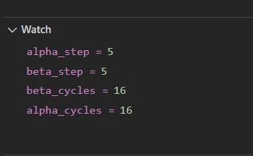
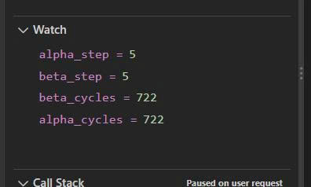
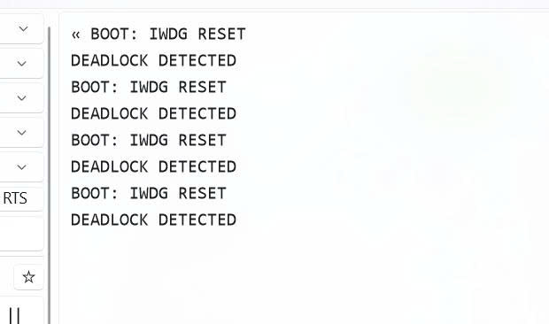
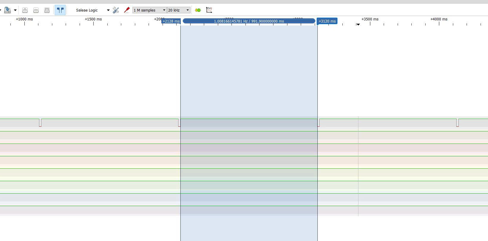
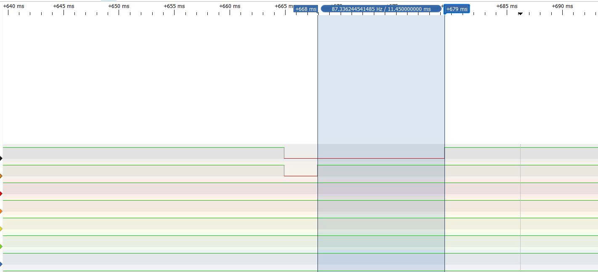
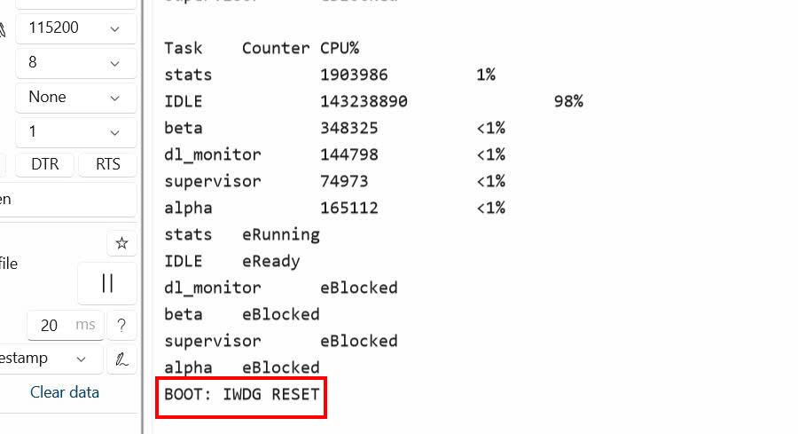
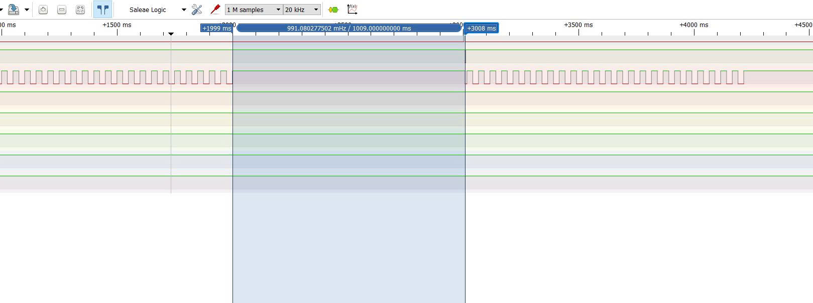
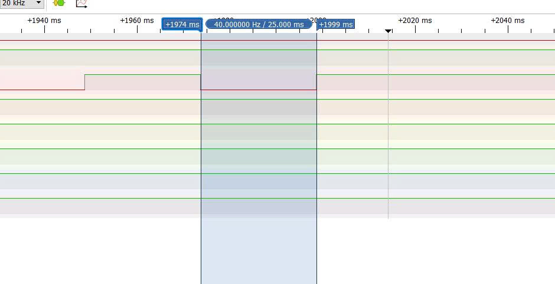

# Report — Week 3 / Ex4

`student_id`: 2510379   Commit của PREDICTION.md: d3042ee

## 1. Bảng CPU %

| Task | CPU % (lần đo 1) | CPU % (lần đo 2) |
|---|---:|---:|
| stats | 1% | 1% |
| IDLE | 98% | 98% |
| beta | <1% | <1% |
| alpha | <1% | <1% | 

Giải thích Idle task chiếm bao nhiêu % và vì sao.

**Trả lời:**
- Idle task chiếm **98% CPU ở cả hai lần đo** vì hai task `alpha` và `beta` bị deadlock khi chờ mutex, còn task `stats` dành phần lớn thời gian ở trạng thái delay.
- Nguyên nhân deadlock là hai task lấy mutex theo thứ tự ngược nhau. Mỗi task đã giữ một mutex và tiếp tục chờ mutex còn lại do task kia giữ. Cả hai đều chưa đến được đoạn trả mutex, nên không task nào có thể tiếp tục thực hiện công việc.
- Khi chờ mutex, `alpha` và `beta` ở trạng thái Blocked, không chạy vòng lặp kiểm tra và không chiếm CPU. Counter của `alpha` giữ nguyên ở **3536**, còn `beta` giữ nguyên ở **12143** giữa hai lần đo, phù hợp với việc hai task không tiếp tục chạy.
- Task `stats` chỉ thức dậy để lấy thống kê và truyền dữ liệu qua UART, sau đó gọi `vTaskDelay()` để chờ lần tiếp theo. Vì vậy, task này chỉ chiếm khoảng **1% CPU**.
- Khi cả hai task xử lý đều bị chặn và task thống kê đang delay, không có task ứng dụng nào sẵn sàng chạy, nên FreeRTOS chạy Idle task. Điều này khiến Idle chiếm phần lớn thời gian CPU, đạt **98%** ở cả hai lần đo.

## 2. Bằng chứng tìm deadlock
Log/ảnh `uxTaskGetSystemState` **trước khi sửa**: trạng thái từng task, chỉ
rõ `task_alpha`/`task_beta` đang `eBlocked` và đang chờ mutex nào. Giải thích
chính xác thứ tự lấy mutex nào gây ra deadlock (AB-BA).

**Trả lời:**

Log thu được từ chương trình:

```
Task    Counter     CPU%
stats   10085132    1%
IDLE    647694777   98%
beta    12163       <1%
alpha   3549        <1%

stats   eRunning
IDLE    eReady
beta    eBlocked
alpha   eBlocked
​
```

Giá trị quan sát trong debugger:

```

alpha_step = 3
beta_step  = 3

```

Hai biến `alpha_step` và `beta_step` đánh dấu task đã chạy đến vị trí nào trong code.

| Giá trị | Alpha | Beta |
|---|---|---|
| 1 | Chuẩn bị lấy mutex A | Chuẩn bị lấy mutex B |
| 2 | Đã lấy được A, tiếp theo delay 5 ms | Đã lấy được B, tiếp theo delay 5 ms |
| 3 | Đã kết thúc delay, chuẩn bị lấy B và vẫn giữ A | Đã kết thúc delay, chuẩn bị lấy A và vẫn giữ B |
| 4 | Đã lấy được cả A và B | Đã lấy được cả B và A |

Alpha gán biến bằng `3` trước khi gọi lấy B. Nếu B đang do beta giữ, alpha bị chặn trong `xSemaphoreTake()`, chưa chạy được dòng gán bằng `4`, nên biến vẫn giữ giá trị `3`.

Beta cũng tương tự: biến giữ giá trị `3` vì task đang chờ A do alpha giữ.

Kết hợp giá trị `3` với trạng thái `eBlocked` và mã nguồn:

| Task | Đang giữ | Đang chờ |
|---|---|---|
| alpha | s_mutex_a | s_mutex_b |
| beta | s_mutex_b | s_mutex_a |


Nguyên nhân deadlock AB–BA
- Mutex chỉ cho phép một task giữ tại một thời điểm. Khi task chờ mutex thứ hai, mutex thứ nhất vẫn do task đó giữ; việc delay hoặc bị Blocked không tự giải phóng mutex.

- Alpha lấy theo thứ tự **A → B**, còn beta lấy theo thứ tự **B → A**. Alpha chờ beta trả B, trong khi beta chờ alpha trả A. Cả hai chỉ đến đoạn trả mutex sau khi lấy được mutex thứ hai, nên không task nào có thể tiếp tục.

## 3. Sửa lỗi
Mô tả thay đổi bạn làm để hết deadlock (thứ tự lấy mutex thống nhất). Xác
nhận chạy ổn định sau khi sửa (thời gian chạy thử).

**Trả lời:**

- Sau khi thống nhất thứ tự lấy mutex A → B, chương trình
được chạy thử trong 20 giây giữa hai lần quan sát.

- Bộ đếm alpha_cycles và beta_cycles đều tăng từ 16 lên 722,
tương ứng mỗi task hoàn thành thêm 706 vòng xử lý.
Ở cả hai lần quan sát, alpha_step và beta_step đều bằng 5,
cho thấy các task đã đi đến đoạn sau khi trả cả hai mutex.

- Kết quả cho thấy cả hai task tiếp tục hoàn thành công việc, không ghi nhận deadlock trong khoảng chạy thử.



## 4. Watchdog
Phép tính reload IWDG. Log/video board tự reset khi deadlock được tái tạo lại
có chủ đích, kèm thời gian từ lúc treo đến lúc reset — so với
`IWDG_TIMEOUT_MS`.

**Trả lời:**

IWDG được cấu hình với `IWDG_TIMEOUT_MS = 1000 ms`, prescaler bằng 32 và tần số LSI danh định 40 kHz:

    Timeout = (Reload + 1) × Prescaler / fLSI

    Reload = (1000 × 40000) / (1000 × 32) − 1
           = 1249

Vì vậy, chọn `IWDG_PRESCALER_32` và `Reload = 1249`, tương ứng timeout danh định 1 giây.

Deadlock được tái tạo có chủ đích bằng cách cho alpha lấy mutex theo thứ tự A → B, còn beta lấy B → A. Khi alpha giữ A và chờ B, beta giữ B và chờ A, cả hai bị chặn và không đến được đoạn `supervisor_checkin()`.

Supervisor không nhận đủ bit báo sống nên không refresh IWDG. Khi bộ đếm hết hạn, IWDG reset board. Sau khi khởi động lại, chương trình kiểm tra cờ reset và in `BOOT: IWDG RESET`, xác nhận nguyên nhân reset là watchdog.




PA6 được kéo HIGH khi monitor phát hiện deadlock. Khi MCU reset, GPIO trở về trạng thái reset và điện trở kéo xuống ngoài đưa PA6 về LOW. Logic Analyzer đo từ cạnh lên đến cạnh xuống tiếp theo, thu được **991,9 ms**.



| Đại lượng | Giá trị |
|---|---:|
| `IWDG_TIMEOUT_MS` | 1000 ms |
| Thời gian từ đánh dấu phát hiện deadlock đến reset | 991,9 ms |
| Chênh lệch | Thấp hơn 8,1 ms|

Phép đo bắt đầu khi monitor phát hiện deadlock, còn IWDG đếm từ lúc khởi động hoặc lần refresh cuối. Hai mốc bắt đầu khác nhau, đồng thời tần số LSI thực tế có thể khác giá trị danh định, nên kết quả không nhất thiết bằng đúng 1000 ms.

Kết quả cho thấy khi deadlock khiến các task ngừng báo sống, supervisor không refresh IWDG và board tự reset. Thời gian đo được gần timeout đã cấu hình.
## 5. Lệch so với dự đoán
Mỗi mục lệch + nguyên nhân.

**Trả lời:**
 **Thời điểm xảy ra deadlock: đúng về cơ chế; thời gian phát hiện đo được là 11,45 ms, lớn hơn khoảng dự đoán 5–10 ms.**

  PA7 được kéo HIGH ngay trước `vTaskStartScheduler()` để đánh dấu bắt đầu chạy scheduler. PA6 được kéo HIGH khi monitor phát hiện deadlock. Đo từ **cạnh lên PA7 đến cạnh lên PA6** bằng Logic Analyzer thu được **11,45 ms**.

Kết quả 11,45 ms cao hơn cận trên dự đoán 10 ms là 1,45 ms, nên gần với khoảng dự đoán. Chênh lệch nhỏ này có thể do monitor kiểm tra theo chu kỳ khoảng 10 ms và phụ thuộc lịch chạy task, khiến thời điểm phát hiện muộn hơn lúc deadlock thực sự xảy ra. Vì vậy, kết quả có thể chấp nhận được khi đối chiếu với dự đoán gần đúng.
    
- **Trạng thái task và mutex đang chờ: đúng với dự đoán.**

  `uxTaskGetSystemState()` ghi nhận cả alpha và beta ở trạng thái `eBlocked`. Debugger cho thấy `alpha_step = 3` và `beta_step = 3`. Đối chiếu code, alpha đã giữ `s_mutex_a` và chờ `s_mutex_b`; beta đã giữ `s_mutex_b` và chờ `s_mutex_a`.

  Cả hai chưa đến được đoạn trả mutex, nên không thể giải phóng tài nguyên cho nhau.

- **Giá trị reload IWDG: đúng với dự đoán theo tần số LSI danh định.**

  Với timeout 1000 ms, LSI 40000 Hz và prescaler 32:

  `Reload = (1000 × 40000) / (1000 × 32) − 1 = 1249`.

  Giá trị cấu hình là 1249, đúng với phép tính dự đoán. Thời gian thực tế phụ thuộc tần số LSI thực tế.

- **Phản ứng khi tái tạo deadlock: đúng về phản ứng reset; thời gian đo gần giá trị dự đoán.**

  Khi deadlock xảy ra, hai task không hoàn thành vòng xử lý và không báo sống. Supervisor không nhận đủ bit nên không refresh IWDG. Log `BOOT: IWDG RESET` xác nhận board khởi động lại do watchdog; hiện tượng lặp lại khi vẫn giữ code gây deadlock.

  Logic Analyzer đo được **991,9 ms** từ lúc đánh dấu phát hiện deadlock đến reset, thấp hơn timeout danh định 1000 ms là **8,1 ms**, tương đương **0,81%**.

  Phép đo này không bắt đầu từ lần refresh cuối. IWDG đã đếm trước khi monitor đánh dấu deadlock, nên hai khoảng thời gian có mốc bắt đầu khác nhau. Tần số LSI thực tế cũng có thể góp phần gây chênh lệch, nhưng chưa có phép đo LSI để xác định mức đóng góp cụ thể.
## 6. Câu hỏi đánh đổi
Với `SUPERVISOR_BITS` và chu kỳ check-in của bạn, nếu một task thật sự chạy
chậm (không deadlock, chỉ chậm) trong đúng 1 chu kỳ, supervisor có false-trip
(reset oan) không? Trả lời bằng số đo thời gian thực tế của chu kỳ check-in.

**Trả lời:**

Có thể xảy ra false-trip nếu một task chỉ chậm trong một chu kỳ nhưng khiến supervisor không refresh kịp trước khi IWDG hết hạn.

- **Cấu hình:** `SUPERVISOR_BITS = 3`, gồm bit alpha, beta và bit supervisor tự đặt. Supervisor chờ đủ bit trong tối đa 500 ms mỗi lần; `IWDG_TIMEOUT_MS = 1000 ms`. Bit tự báo của supervisor không thay thế được bit alpha hoặc beta còn thiếu.

- **Chu kỳ check-in bình thường:** đo bằng cách toggle PA8 sau mỗi lần alpha check-in. Khoảng cách giữa hai cạnh liên tiếp đo được khoảng **25 ms**, phù hợp với các khoảng delay 5 ms và 20 ms trong vòng xử lý.

- **Thử nghiệm task chậm:** thêm delay **1200 ms đúng một vòng** của alpha, sau khi trả cả hai mutex và trước check-in. Alpha chỉ chờ hết delay, không giữ mutex gây deadlock. Tuy nhiên, supervisor thiếu bit alpha nên không refresh kịp; log `BOOT: IWDG RESET` xác nhận board đã reset do watchdog.

- **Kết quả đo:** Logic Analyzer ghi nhận đoạn PA8 không đổi mức dài khoảng **1009 ms** trước khi tín hiệu tiếp tục xuất hiện. Đây là khoảng gián đoạn bao quanh lần reset, **không phải chu kỳ check-in hoàn chỉnh 1200 ms**, vì alpha chưa kết thúc delay thì board đã reset. Khoảng đo có thể bao gồm thời gian khởi động lại đến khi PA8 đổi mức.

Hết thời gian chờ 500 ms không trực tiếp gây reset; supervisor tiếp tục chờ ở vòng sau. Reset xảy ra khi thời gian không được refresh vượt timeout thực tế của IWDG.

**Đánh đổi:** timeout ngắn giúp phục hồi nhanh khi task treo, nhưng có thể reset oan khi task xử lý chậm hợp lệ. Timeout dài chịu được những lần chậm hơn, nhưng cũng kéo dài thời gian phục hồi khi có lỗi. Với thử nghiệm chậm 1200 ms, cấu hình timeout 1000 ms đã gây false-trip.


