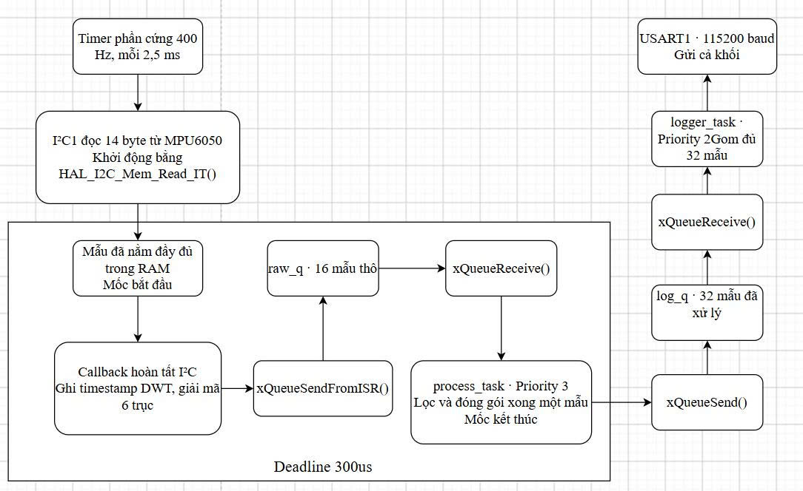

# Report — Week 4 / Ex1 (Design doc)

`student_id`: 2510379    Commit của PREDICTION.md: a204598

> File này ĐÓNG VAI TRÒ design doc 2–3 trang nộp cho mentor duyệt trước khi
> viết code. Điền đủ số liệu — không mô tả chung chung.

## 1. Task diagram
Mô tả (sơ đồ ASCII hoặc ảnh chèn vào) luồng: ISR lấy mẫu MPU6050 → hàng đợi
→ task xử lý → task ghi UART. Ghi rõ priority từng task.

## 2. Timing budget

| Đại lượng | Công thức / nguồn số liệu | Giá trị |
|---|---|---:|
| Chu kỳ lấy mẫu | 1.000.000 / 400 | 2.500 µs |
| Latency ISR → task | Đo thực tế Week 3 / Ex1, có `portYIELD_FROM_ISR()` | 10,667 µs |
| Thời gian xử lý 1 mẫu | Ước lượng thời gian lọc 6 trục và đóng gói | 50 µs |
| Tổng thời gian | 10,667 + 50 | **60,667 µs** |
| Deadline | `ISR_TO_PROC_DEADLINE_US` | 300 µs |
| Thời gian còn dư | 300 − 60,667 | **239,333 µs** |
| Kết quả dự đoán | 60,667 < 300 | **Đạt** |

## 3. RAM budget

Mỗi `sensor_sample_t` chiếm `4 + 6 × 2 = 16 B`, gồm timestamp 4 B và sáu giá trị gia tốc/gyro, mỗi giá trị 2 B.

| Thành phần | Kích thước | Ghi chú |
|---|---|---|
| Queue (độ dài × cỡ phần tử) | `16 × 16 + 32 × 16 = 768 B` | `raw_q` giữ 16 mẫu, `log_q` giữ 32 mẫu. |
| Stack task lấy mẫu | `0 B` heap | Sử dụng Timer ISR, không tạo task lấy mẫu riêng. ISR sử dụng MSP. |
| Stack task xử lý | `128 × 4 = 512 B` | Tham chiếu `dyn_task` ở Week 1. Stack dùng tối đa `160 − 133 = 27 words`. |
| Stack task ghi UART | `256 × 4 = 1.024 B` | Tham chiếu `ram_report_task` ở Week 1. Stack dùng tối đa `512 − 328 = 184 words`. |
| Stack Idle task | `128 × 4 = 512 B` | Theo giả định `configMINIMAL_STACK_SIZE = 128`. |
| Overhead cấp phát | `336 + 256 + 8 = 600 B` | 336 B cho 3 task; dự phòng 128 B cho mỗi queue; 8 B quản lý cuối heap theo số đo Week 1. |
| **Tổng heap dự kiến** | **`768 + 512 + 1.024 + 512 + 600 = 3.416 B`** | `MAX_HEAP_BYTES = 10.240 B`, còn dư `10.240 − 3.416 = 6.824 B`. |
| Buffer nhận I²C | 14 B | Lưu 14 byte đọc từ MPU6050. Khai báo `static` để buffer còn tồn tại đến khi callback hoàn tất. |
| Buffer gom khối UART | `32 × 16 = 512 B` | Gom đủ 32 mẫu trước khi truyền. Buffer này tách riêng khỏi `log_q`. |
| **Tổng hai buffer** | **526 B** | RAM tĩnh, tính riêng với `3.416 B` FreeRTOS heap dự kiến. |

**Căn cứ tính overhead:**

- Trong Week 1, tạo thêm một task có stack 128 words (512 B) làm heap giảm 624 B. Overhead mỗi task là `624 − 512 = 112 B`. Với 3 task gồm `process_task`, `logger_task` và Idle, overhead là `3 × 112 = 336 B`.
- Dự phòng `2 × 128 = 256 B` cho cấu trúc quản lý và cấp phát của hai queue.
- Cộng thêm 8 B quản lý cuối heap theo kết quả đo Week 1.

## 4. Lựa chọn API đồng bộ
Queue / event group / stream buffer — vì sao chọn cái này cho pipeline này.

Em chọn **Queue** để truyền dữ liệu giữa các giai đoạn trong pipeline vì dữ liệu MPU6050 được tổ chức thành các mẫu có cấu trúc cố định (`sensor_sample_t`), gồm timestamp và sáu giá trị gia tốc/gyro.

- **Queue đầu vào (`raw_q`):** ISR sử dụng `xQueueSendFromISR()` để đưa mẫu cảm biến vào queue. `process_task` sử dụng `xQueueReceive()` để lấy mẫu, lọc và đóng gói. Queue bảo toàn thứ tự FIFO và đánh thức task xử lý khi có mẫu mới.

- **Queue đầu ra (`log_q`):** `process_task` sử dụng `xQueueSend()` để gửi các mẫu đã xử lý vào queue. `logger_task` sử dụng `xQueueReceive()` để nhận dữ liệu, gom đủ 32 mẫu rồi gửi qua UART.

- **Event Group:** Không phù hợp để truyền dữ liệu cảm biến vì chỉ lưu trạng thái các bit sự kiện, không lưu được toàn bộ cấu trúc mẫu và không bảo toàn từng lần dữ liệu đến.

- **Stream Buffer:** Phù hợp với luồng byte liên tục như UART RX, nhưng pipeline này truyền các phần tử `sensor_sample_t` có cấu trúc cố định nên Queue phù hợp hơn.

**Kết luận:** Queue phù hợp với mô hình producer–consumer của pipeline, bảo toàn từng mẫu theo thứ tự FIFO, hỗ trợ truyền dữ liệu trực tiếp từ ISR thông qua API `FromISR` và cho phép kiểm soát tình trạng đầy queue để thống kê số mẫu bị mất.

## 5. Xử lý khi hàng đợi đầy
Drop mẫu mới hay mẫu cũ? Có đếm số mẫu bị rớt để báo cáo ở ex3 không?

Em chọn phương án **Drop mẫu mới (Drop Newest)** cho cả hai queue để giữ nguyên các mẫu cũ đang chờ xử lý, đảm bảo thứ tự FIFO và tránh làm mất dữ liệu đã được đưa vào queue trước đó.

- **Queue mẫu thô (`raw_q`):** Khi ISR gọi `xQueueSendFromISR()` nhưng queue đã đầy, mẫu mới không được đưa vào queue. ISR tăng biến đếm `drop_raw` để ghi nhận số mẫu bị mất.
- **Queue đầu ra (`log_q`):** Nếu `process_task` gửi mẫu đã xử lý nhưng queue đầy, mẫu mới bị loại bỏ và biến `drop_log` được tăng lên.
- **Thống kê mẫu mất:** Duy trì hai bộ đếm `drop_raw` và `drop_log` riêng biệt. Trong Ex3, đọc và xuất các bộ đếm qua UART để xác định số mẫu mất ở từng giai đoạn.

Việc bỏ mẫu mới giúp ISR không phải chờ queue giải phóng chỗ, tránh kéo dài thời gian phục vụ ngắt và ảnh hưởng đến chu kỳ lấy mẫu 400 Hz. Các bộ đếm giúp xác định chính xác số mẫu bị mất do queue đầy.

## 6. Mentor duyệt
Chữ ký / ghi chú của mentor sau buổi duyệt thiết kế: ______
